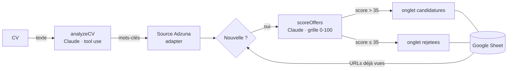

# job-agent

[](https://github.com/aagadaz/job-agent/actions/workflows/daily.yml)

Agent de recherche d'emploi qui lit mon CV, récupère chaque matin les offres récentes, les note avec Claude et range les plus pertinentes dans un Google Sheet.

Chaque jour à 7h (heure de Paris), une GitHub Action :

1. extrait du CV des mots-clés de recherche (Claude, sortie structurée) ;
2. récupère les offres CDI publiées depuis moins de 14 jours via l'API Adzuna ;
3. écarte les offres déjà vues lors des exécutions précédentes ;
4. note chaque nouvelle offre de 0 à 100 par rapport au CV, avec justification, points forts et compétences manquantes ;
5. ajoute au Sheet les offres notées au-dessus de 35, et mémorise les autres pour ne pas les re-noter.

## Architecture



Le Google Sheet sert à la fois de tableau de suivi (colonne **Statut** mise à jour à la main) et de mémoire de l'agent.

## Choix techniques

| Choix | Pourquoi |
|---|---|
| **Sortie structurée par tool use forcé** | Claude répond via un outil décrit par un JSON Schema (`tool_choice`), donc un objet typé plutôt que du texte à parser. |
| **Grille de notation explicite** | Compétences (40), niveau d'expérience (25), domaine (20), conditions (15) : des scores comparables d'une offre à l'autre. Le verdict (*Postuler / À étudier / Ignorer*) est calculé par le code à partir du score, pas généré par le modèle. |
| **Pattern Adapter pour les sources** | `src/sources/adzuna.ts` traduit le format de l'API vers un type commun `JobDetail`. Ajouter une source ne touche ni au scoring ni au Sheet. |
| **Idempotence** | Relancer l'agent ne crée ni doublon ni en-tête réécrit. Les onglets sont créés s'ils manquent, et la déduplication se fait par URL normalisée, avec un `Set` en O(1). |
| **Append-only** | L'agent n'écrit qu'en fin de tableau : le suivi manuel n'est jamais écrasé. |
| **Robustesse réseau** | Retry avec backoff exponentiel sur les erreurs transitoires (429, 5xx), scoring en pool de 3 requêtes concurrentes, et dégradation gracieuse : une offre non notée est conservée. |
| **API plutôt que scraping** | La première version scrapait l'APEC avec Playwright. Le site bloque désormais les navigateurs automatisés, d'où le passage à une API publique documentée. |

## Stack

TypeScript (mode `strict`) · Node.js 22 · API Anthropic (Claude Haiku) · API Adzuna · Google Sheets API (compte de service) · pdf-parse · GitHub Actions

## Structure

```
src/
├── main.ts                 # orchestration du pipeline
├── lib/
│   ├── types.ts            # modèle de domaine partagé (JobDetail, OfferScore…)
│   ├── cv-analyzer.ts      # CV → texte + paramètres de recherche
│   ├── scorer.ts           # notation des offres par Claude
│   └── sheets.ts           # lecture/écriture Google Sheets, déduplication
├── sources/
│   └── adzuna.ts           # adapter API Adzuna
├── tools/
│   └── export-cv-text.ts   # extrait le texte du CV pour la CI
└── scrapers/
    └── apec.ts             # première version (scraping), plus utilisée
```

## Installation locale

Prérequis : Node.js 22, une clé API Anthropic, un compte développeur [Adzuna](https://developer.adzuna.com), un compte de service Google Cloud avec l'API Sheets activée.

```bash
git clone https://github.com/aagadaz/job-agent.git
cd job-agent
npm install
cp .env.example .env   # puis renseigner les valeurs
```

Partager le Google Sheet (accès **Éditeur**) avec l'adresse e-mail du compte de service (`…@….iam.gserviceaccount.com`). Les onglets `candidatures` et `rejetees` sont créés automatiquement.

| Variable | Rôle |
|---|---|
| `ANTHROPIC_API_KEY` | Clé API Anthropic |
| `ADZUNA_APP_ID`, `ADZUNA_APP_KEY` | Identifiants Adzuna |
| `GOOGLE_SHEET_ID` | ID du classeur (dans son URL) |
| `GOOGLE_CREDENTIALS_PATH` | Chemin du JSON du compte de service (local) |
| `GOOGLE_CREDENTIALS_JSON` | Contenu de ce JSON (CI, remplace le chemin) |
| `CV_PATH` | Chemin du CV PDF (local) |
| `CV_TEXT` | Texte du CV (CI, remplace le PDF) |
| `SCORE_REJECT_THRESHOLD` | Seuil d'exclusion, 35 par défaut |
| `CLAUDE_MODEL` | Modèle Claude, Haiku par défaut |

```bash
npm run typecheck   # vérification des types
npm start           # exécution complète
```

## Exécution quotidienne (GitHub Actions)

Le workflow `.github/workflows/daily.yml` tourne chaque jour à 7h heure de Paris, et peut aussi être lancé à la main depuis l'onglet **Actions** (*Run workflow*). Les crons GitHub étant en UTC, deux horaires sont planifiés (5h et 6h UTC) et un premier job ne laisse passer que celui qui correspond à 7h à Paris, quelle que soit la saison.

Secrets à créer dans *Settings → Secrets and variables → Actions* : `ANTHROPIC_API_KEY`, `ADZUNA_APP_ID`, `ADZUNA_APP_KEY`, `GOOGLE_SHEET_ID`, `GOOGLE_CREDENTIALS_JSON`, `CV_TEXT`.

```bash
npm run cv:text                                   # écrit cv.txt (ignoré par git)
gh secret set CV_TEXT < cv.txt
gh secret set GOOGLE_CREDENTIALS_JSON < credentials.json
```

Le CV et les identifiants ne sont jamais versionnés.

## Limites connues

- Adzuna ne fournit qu'un extrait de chaque annonce : le score est un premier tri, pas un verdict. Il faut lire l'annonce complète avant de postuler.
- Le planificateur de GitHub peut retarder une exécution de quelques minutes. Sur un dépôt public, les workflows planifiés sont désactivés après 60 jours sans activité sur le dépôt.

## Pistes

- Source France Travail (API Offres d'emploi), dès que l'accès sera rouvert
- Brouillon de lettre de motivation pour les offres notées 70 et plus
- Préfiltrage par embeddings pour réduire le coût du scoring
- Tests unitaires (`normalizeUrl`, `verdictFromScore`) et validation des réponses avec Zod

---

Projet personnel d'[Afzal Agadazi](https://github.com/aagadaz).
